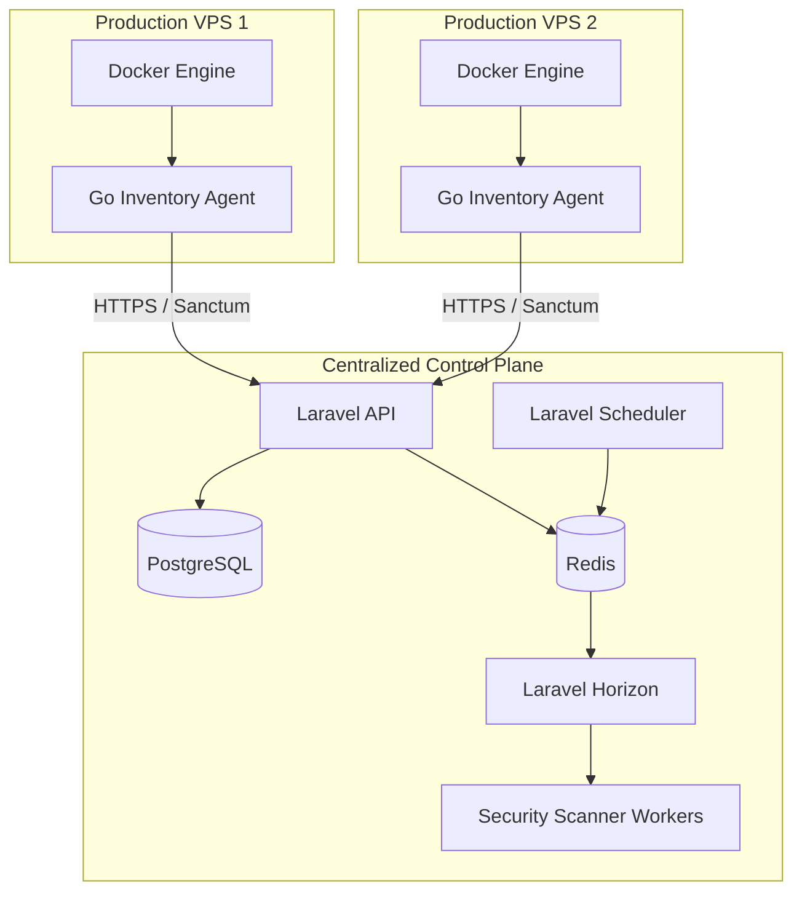

# DevSecOps Monitor

**Centralized DevSecOps Security Monitoring Platform**

DevSecOps Monitor is a centralized platform designed to monitor the security of applications and Docker infrastructure across multiple servers.

It integrates Docker inventory monitoring, vulnerability scanning, dependency analysis, and vulnerability management into a unified platform.

The primary goal is to help developers and system administrators identify security risks, monitor deployment environments, and manage vulnerability remediation through a centralized interface.

> **Project Status:** Under Development

---

## Table of Contents

- [Overview](#overview)
- [Key Features](#key-features)
- [Architecture](#architecture)
- [Technology Stack](#technology-stack)
- [Project Structure](#project-structure)
- [Getting Started](#getting-started)
- [Environment Configuration](#environment-configuration)
- [API Endpoints](#api-endpoints)
- [Security Design](#security-design)
- [Development Roadmap](#development-roadmap)
- [License](#license)

---

## Overview

In environments where multiple servers and Docker-based applications are deployed, security monitoring is often performed independently across different systems. This makes it difficult to identify vulnerabilities, track deployment changes, and manage security scanning results consistently.

DevSecOps Monitor addresses this challenge through a centralized control plane and agent-based architecture.

The platform consists of two primary components:

1. **Centralized Control Plane**

   The main application responsible for managing Docker hosts, projects, container inventories, repositories, vulnerability findings, and scanning operations.

2. **Docker Inventory Agent**

   A lightweight Go-based agent deployed on each server to collect Docker metadata and synchronize it with the centralized API.

This architecture allows each server to initiate outbound communication with the control plane without exposing its Docker Engine directly to the central application.

---

## Key Features

### 1. Docker Host Management

- Register and manage multiple Docker hosts.
- Identify servers using hostname information.
- Monitor agent connection status.
- Track agent heartbeat and version information.
- Token-based authentication using Laravel Sanctum.

### 2. Docker Inventory Monitoring

- Collect Docker container metadata.
- Discover Docker Compose projects.
- Group containers by Compose project and service.
- Identify image references and image digests.
- Synchronize inventory from multiple Docker hosts.

### 3. Vulnerability Scanning

Planned capabilities:

- Docker image vulnerability scanning using Trivy.
- Source code dependency scanning.
- Operating system package vulnerability detection.
- SBOM generation using Syft or CycloneDX.
- Supplementary dependency analysis using OSV-Scanner.

### 4. Vulnerability Management

Planned capabilities:

- Centralized vulnerability findings.
- Severity classification: Critical, High, Medium, Low, and Unknown.
- Finding lifecycle tracking: New, Existing, and Resolved.
- Vulnerability fingerprinting.
- Scan history and vulnerability trend analysis.

### 5. Repository Integration

Planned capabilities:

- GitHub repository integration.
- Repository and branch synchronization.
- Default branch detection.
- Deployed commit tracking.
- Source code scanning across repositories and branches.

### 6. Automated Remediation

Planned capabilities:

- Dependency update recommendations.
- Isolated remediation workspaces.
- Automated testing and build validation.
- Security branch generation.
- GitHub Pull Request creation.
- Approval workflows before changes are applied.

---

## Architecture

DevSecOps Monitor follows a centralized control plane architecture with lightweight agents deployed on individual Docker hosts.



### Component Responsibilities

| Component | Responsibility |
|---|---|
| Nuxt Frontend | Monitoring dashboard and user interface |
| Laravel API | Business logic, authentication, and orchestration |
| PostgreSQL | Persistent application and security data |
| Redis | Queue, cache, and background task coordination |
| Laravel Horizon | Queue worker monitoring |
| Laravel Scheduler | Periodic task scheduling |
| Go Agent | Docker inventory collection and synchronization |
| Trivy | Container image and filesystem vulnerability scanning |
| OSV-Scanner | Dependency vulnerability analysis |
| Syft | SBOM generation |

### Inventory Synchronization Flow

1. The agent connects to the Docker Engine on its host.
2. The agent collects container metadata.
3. The agent groups containers by Docker Compose project.
4. The agent sends inventory data to the centralized Laravel API.
5. Laravel authenticates the agent using its Sanctum token.
6. Laravel synchronizes Docker host, project, and container records.
7. The collected inventory becomes available for centralized monitoring.

---

## Technology Stack

| Layer | Technology |
|---|---|
| Frontend | Nuxt 4, JavaScript |
| Backend | Laravel, PHP |
| Database | PostgreSQL |
| Cache | Redis |
| Queue Management | Laravel Horizon |
| Task Scheduling | Laravel Scheduler |
| Agent | Go |
| Container Runtime | Docker Engine |
| Container Scanning | Trivy |
| Dependency Scanning | OSV-Scanner |
| SBOM | Syft / CycloneDX |
| Repository Integration | GitHub API |
| Development Environment | Docker Compose |
| Deployment | Linux VPS, Docker |

---

## Project Structure

Current and planned repository structure:

```text
devsecops-monitor/
│
├── backend/
│   ├── app/
│   │   ├── Console/
│   │   ├── Http/
│   │   │   └── Controllers/
│   │   │       └── Api/
│   │   │           └── Agent/
│   │   │               ├── HeartbeatController.php
│   │   │               └── InventoryController.php
│   │   └── Models/
│   ├── database/
│   │   └── migrations/
│   ├── routes/
│   │   └── api.php
│   ├── Dockerfile
│   └── .env
│
├── agent/
│   └── (Go Inventory Agent - in development)
│
├── frontend/
│   └── (Nuxt Dashboard - planned)
│
├── deployment/
│   └── docker-compose.dev.yml
│
└── README.md
```

---

## Getting Started

### Prerequisites

Make sure the following tools are installed:

- Docker Desktop or Docker Engine.
- Docker Compose.
- Git.
- Go (for agent development).
- A GitHub account (for future repository integration).

### 1. Clone the Repository

```bash
git clone <repository-url>
cd devsecops-monitor
```

### 2. Configure Backend Environment

Prepare the Laravel environment file:

```bash
cd backend
cp .env.example .env
```

Configure the database and Redis connection:

```env
APP_ENV=local
APP_DEBUG=true
APP_URL=http://localhost:18080

DB_CONNECTION=pgsql
DB_HOST=postgres
DB_PORT=5432
DB_DATABASE=devsecops
DB_USERNAME=devsecops
DB_PASSWORD=dev_password_local

CACHE_STORE=redis
SESSION_DRIVER=redis
QUEUE_CONNECTION=redis

REDIS_CLIENT=predis
REDIS_HOST=redis
REDIS_PASSWORD=null
REDIS_PORT=6379
```

Return to the project root:

```bash
cd ..
```

### 3. Start the Development Environment

```bash
docker compose -f deployment/docker-compose.dev.yml up -d --build
```

The development environment starts:

- Laravel API
- PostgreSQL
- Redis
- Laravel Horizon
- Laravel Scheduler

### 4. Generate the Application Key

```bash
docker compose -f deployment/docker-compose.dev.yml exec api php artisan key:generate
```

### 5. Run Database Migrations

```bash
docker compose -f deployment/docker-compose.dev.yml exec api php artisan migrate
```

### 6. Verify Services

```bash
docker compose -f deployment/docker-compose.dev.yml ps
```

Check Horizon:

```bash
docker compose -f deployment/docker-compose.dev.yml exec api php artisan horizon:status
```

### 7. Access the API

The local Laravel API is available at:

```text
http://localhost:18080
```

---

## Environment Configuration

Development services use the following local ports:

| Service | Host Port | Container Port |
|---|---:|---:|
| Laravel API | 18080 | 8000 |
| PostgreSQL | 5433 | 5432 |
| Redis | 6380 | 6379 |

All development ports are bound to `127.0.0.1`.

The development database and Redis use Docker named volumes to preserve data between container restarts.

**Important:** The credentials shown above are development-only examples. Production credentials must be stored securely and must never be committed to Git.

---

## API Endpoints

Current agent API endpoints:

| Method | Endpoint | Description | Required Ability |
|---|---|---|---|
| POST | `/api/agent/heartbeat` | Update agent heartbeat and version | `heartbeat:write` |
| POST | `/api/agent/inventory` | Synchronize Docker inventory | `inventory:write` |

All agent endpoints require Laravel Sanctum authentication.

### Heartbeat

Example request:

```http
POST /api/agent/heartbeat
Authorization: Bearer <AGENT_TOKEN>
Content-Type: application/json
```

```json
{
  "agent_version": "0.1.0"
}
```

### Inventory Synchronization

Example request:

```http
POST /api/agent/inventory
Authorization: Bearer <AGENT_TOKEN>
Content-Type: application/json
```

```json
{
  "projects": [
    {
      "docker_project_name": "my-application",
      "containers": [
        {
          "container_id": "abcdef123456",
          "container_name": "my-application-app-1",
          "service_name": "app",
          "image_reference": "my-application:latest",
          "image_digest": "sha256:example",
          "container_state": "running"
        }
      ]
    }
  ]
}
```

The values above are illustrative. Actual inventory data is collected by the Go Agent.

---

## Security Design

Security is a core consideration in the platform architecture.

Key design principles:

- **Outbound Agent Communication:** Agents initiate connections to the centralized API.
- **Token-Based Authentication:** Each Docker host has its own Sanctum personal access token.
- **Scoped Abilities:** Tokens receive only the permissions required by the agent.
- **Secret Protection:** Container environment variables and application secrets must never be included in inventory payloads.
- **No Direct Docker Socket Access:** The Laravel API must not directly access the Docker socket.
- **Immutable Scan Targets:** Image scanning should use immutable image digests whenever possible.
- **Isolated Scanning:** Security scanning and remediation workloads should run in isolated workers.
- **Auditability:** Scan execution and remediation actions should be traceable.
- **Least Privilege:** Production services and agents should receive only the permissions they require.

Never commit `.env` files, agent tokens, private keys, GitHub credentials, or other secrets to the repository.

---

## Development Roadmap

The project is being developed incrementally.

- [x] Initialize Laravel backend.
- [x] Configure PostgreSQL.
- [x] Configure Redis.
- [x] Install Laravel Horizon.
- [x] Configure Laravel Scheduler.
- [x] Create Docker Host management schema.
- [x] Create Project and Container inventory schema.
- [x] Create Scan Run and Finding schema.
- [x] Create Repository and Branch schema.
- [x] Configure Laravel Sanctum for agent authentication.
- [x] Implement Docker Host registration command.
- [x] Implement Agent heartbeat endpoint.
- [x] Implement Agent inventory synchronization endpoint.
- [ ] Develop Go Docker Inventory Agent.
- [ ] Implement inventory reconciliation and stale container handling.
- [ ] Develop Nuxt monitoring dashboard.
- [ ] Implement Trivy image scanning.
- [ ] Implement source dependency scanning.
- [ ] Implement SBOM generation.
- [ ] Implement vulnerability lifecycle tracking.
- [ ] Implement GitHub integration.
- [ ] Implement automated scanning schedules.
- [ ] Implement isolated remediation workflow.
- [ ] Implement GitHub Pull Request automation.
- [ ] Integrate CI/CD security gates.
- [ ] Deploy production environment.

---

## License

This project is currently under development. Licensing and distribution terms will be defined in a future release.